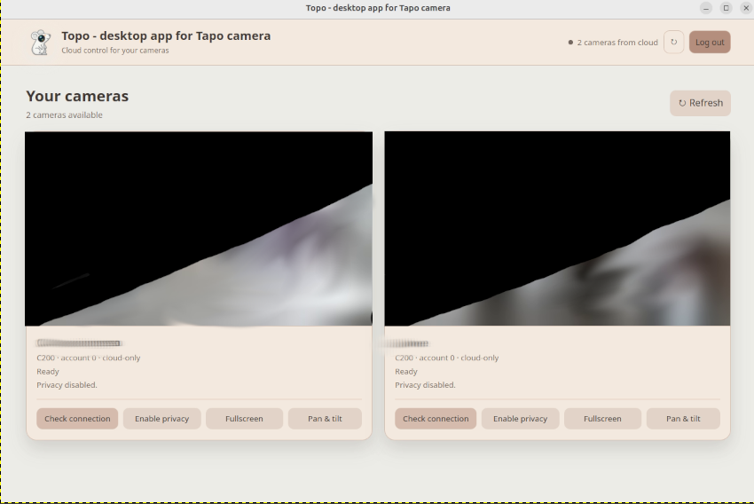

<p align="center">
  
</p>

<h1 align="center">Topo</h1>

<p align="center">
  <strong>Desktop app for Tapo camera</strong><br>
  View and control your Tapo cameras from a clean Linux desktop window.
</p>

<p align="center">
  
  
  
</p>

<p align="center">
  
</p>

Topo is a standalone Linux desktop application for viewing and controlling
Tapo cameras through the Tapo cloud account.

It uses Tapo's cloud relay and does not require RTSP, port forwarding, a VPN,
or direct access to the camera's home network. The application starts a local
GTK/WebKit desktop window; no browser needs to be opened manually.

> **Experimental:** the cloud integration relies on undocumented Tapo
> endpoints and may need updates if Tapo changes its service.

## At a glance

| | |
|---|---|
| **Connection** | Tapo cloud relay — no RTSP, port forwarding, VPN, or camera LAN access |
| **Desktop shell** | GTK 3 + WebKitGTK 4.1 |
| **Video pipeline** | Cloud relay decoded by FFmpeg and shown in the desktop UI |
| **Authentication** | Tapo account login with MFA and reusable session |
| **Controls** | Privacy toggle, relay check, pan/tilt, and per-camera fullscreen |

## Features

- View multiple Tapo camera live streams in the same window.
- Cloud relay connection check for each camera.
- Graphical Tapo account login.
- MFA login through the Tapo app notification or email code.
- Session reuse across launches, so MFA is not requested every time.
- Logout support that clears the saved session.
- Per-camera privacy mode toggle.
- Pan and tilt for compatible cameras.
- Compact pan/tilt control panel with movement steps 5, 10, and 20.
- Smart movement-panel placement: below, above, or detached and centered when
  there is not enough room.
- Per-camera fullscreen mode.
- Double-click or keyboard activation of a camera preview to enter fullscreen.
- Fullscreen command drawer, so controls do not cover the video permanently.
- Stream loading state, error state, and retry button.
- Responsive layout for different window sizes.
- Linux desktop launcher with the Topo icon.

## Tested cameras

The following model has been tested with Topo:

| Model | Live video | Privacy mode | Pan & tilt |
|---|---:|---:|---:|
| Tapo C200 | Yes | Yes | Yes |

More testers are welcome. If you use another Tapo camera model, please open an
issue with the model name, firmware version, and which features work. Do not
include account credentials, session tokens, or private camera footage.

## Current limitations

- This version displays video only; audio is not currently implemented.
- Desktop motion/event notifications are not currently implemented.
- Recording and snapshots are not currently implemented.
- Pan/tilt is available only for cameras supported by the Tapo cloud account.
- A working Internet connection and an active Tapo account are required.

## Requirements

- Linux desktop environment with GTK 3.
- Python 3.
- WebKitGTK 4.1.
- FFmpeg.
- A Tapo account with access to the cameras.

The installer supports automatic dependency detection and installation on
Ubuntu/Debian and Fedora/RHEL. On other distributions, install the
requirements manually before running the installer.

On Fedora, FFmpeg may require an additional multimedia repository such as RPM
Fusion, depending on the system configuration.

## Installation

Clone the repository and run the Linux installer:

```bash
git clone https://github.com/filirnd/topo.git
cd topo
chmod +x linux/install.sh linux/uninstall.sh
./linux/install.sh
```

The installer:

1. checks Python 3, GTK 3, WebKitGTK 4.1, and FFmpeg;
2. identifies Ubuntu/Debian or Fedora/RHEL when dependencies are missing;
3. asks for confirmation before using `apt` or `dnf`;
4. installs the application under the user's local data directory;
5. creates a desktop launcher and installs the Topo icon.

After installation, launch **Topo - desktop app for Tapo camera** from the
desktop application menu.

To uninstall:

```bash
./linux/uninstall.sh
```

## Flatpak distribution

Topo can also be distributed through a self-hosted Flatpak repository on
GitHub Pages. This provides a clickable `.flatpakref` installer and normal
Flatpak updates without requiring a Flathub submission.

The repository is published automatically by GitHub Actions after the
repository signing key and GitHub Pages have been configured. The public
installation link will be:

```text
https://filirnd.github.io/topo/io.github.filirnd.topo.flatpakref
```

Install directly from the published repository with Flatpak:

```bash
flatpak install --user https://filirnd.github.io/topo/io.github.filirnd.topo.flatpakref
```

The `.flatpakref` can also be downloaded and opened with GNOME Software when
Flatpak support is enabled. The repository is added automatically and future
application updates can be installed with:

```bash
flatpak update --user
```

The Flatpak package is cloud-only and needs network access, but it does not
need RTSP, Tailscale, a Raspberry Pi, or access to the home LAN.

### Maintainer setup

To publish the repository from GitHub Actions:

1. Generate a dedicated GPG signing key and keep its private key out of Git:

   ```bash
   gpg --quick-gen-key "Topo Flatpak Repository" ed25519 sign 0
   gpg --armor --export-secret-keys <fingerprint> > topo-flatpak-private.asc
   ```

2. Add the contents of `topo-flatpak-private.asc` as the repository secret
   `GPG_PRIVATE_KEY`. Add the key passphrase as `GPG_PASSPHRASE` if the key is
   protected by one.
3. In the repository settings, enable **Pages** with **GitHub Actions** as the
   source.
4. Push to `main` or run the **Flatpak repository** workflow manually.

The workflow signs the repository, publishes the Flatpak metadata and creates
the clickable `.flatpakref` installer. Rotate the GPG key only with a planned
repository migration, because installed clients trust the repository key.

## Login and session storage

On the first launch, enter the Tapo account credentials. If MFA is required,
choose either the Tapo app notification or the email verification code.

The application stores a session token at:

```text
~/.local/state/tapo-cloud-probe/session.json
```

The password is not stored. Use **Logout** to clear the session and require a
new login on the next launch.

To force a fresh login when launching the installed wrapper manually:

```bash
~/.local/share/tapo-cloud-viewer/run-tapo-cloud-viewer --fresh-login
```

## Security notes

- Treat `session.json` as a credential and never publish it.
- Do not commit account passwords, session tokens, or private camera data.
- The app adds the TP-Link public cloud root certificates used by the official
  Tapo Android client to the normal system trust store. TLS certificate
  validation and hostname verification remain enabled; the app does not
  provide a TLS verification bypass.
- The local HTTP service is bound to `127.0.0.1` and is used only by the
  desktop WebKit window.

## Development

Run the desktop shell directly from the repository after installing the system
dependencies:

```bash
python3 tapo_desktop.py
```

Useful options:

```text
--fresh-login    force a new Tapo login and MFA flow
--port PORT      use a specific local HTTP port (0 selects a free port)
```

## AI Full Disclosure

This software was developed with substantial assistance from AI coding agents,
with humans leading the ideas, architecture decisions, testing, and debugging.
We state this openly because AI assistance shaped how the project was built.
If you are not comfortable using software developed with AI assistance, this
project may not be for you.

The final responsibility for the code, its behavior, and its security remains
with the project author. The Tapo cloud integration also relies on undocumented
endpoints and may require maintenance when the upstream service changes.

## License

Topo is released under the [MIT License](LICENSE).
